# Graph Distiller

> **지식체계 압축 제공 (Asynchronous Batch Knowledge Compiler)**  
> 파편화된 비구조화 메모를 GraphRAG와 PageRank 컨텍스트 압축 기법을 통해 사람이 읽을 수 있는 구조화된 지식 단행본(**The Living Codex**)으로 자동 편찬하는 비동기 배치 컴파일러입니다.

[](https://python.org)
[]()
[]()

---

## 1. 해결하고자 하는 문제 (The "Why")

엔터프라이즈 환경이나 개인 연구에서 축적되는 수천~수만 건의 지식 메모(`.txt`, `.md`, `.docx`, `.json`)는 고도로 파편화되어 있습니다. 기존의 단순 벡터 검색 기반 RAG(Vector RAG)는 다음과 같은 고질적 한계를 가집니다:

1. **전역적 맥락(Global Context)과 지식 위계(Hierarchy) 부재:**  
   단순 유사도 검색은 질문과 표면적으로 비슷한 문장 조각 몇 개만 집어낼 뿐, 전체 지식의 숲(목차, 상하 관계, 인과 흐름)을 조망하지 못합니다.
2. **환각(Hallucination)과 맥락 단절:**  
   검색된 조각들 사이에 논리적 다리가 없을 때, LLM은 그럴듯한 거짓말을 만들어내거나 상반된 사실을 왜곡합니다.

**Graph Distiller는 질문에 1~2초 만에 답하는 챗봇이 아닙니다.**  
수십만 토큰의 파편 지식을 밤새 정밀 분석하여, 전체 개념 간의 연결망을 그래프로 엮고, 사람이 통독할 수 있는 한 권의 **구조화된 마크다운 책(`The Living Codex`)**으로 영구 컴파일하는 **배치 컴파일러 엔진**입니다.

---

## 2. 핵심 엔지니어링 특징 (Engineering Highlights)

### 🚀 1. 프레임워크 비의존성 (Zero Black-Box Frameworks)
LangGraph, CrewAI 등 무거운 외부 에이전트 프레임워크의 블랙박스 추상화에 의존하지 않습니다.  
엔진 코어는 **순수 Python 기반의 무상태 상태 머신(`SimpleLoop`: Planner → RepoMap → Synthesizer → Verifier)**으로 구현되어 있습니다. 상태 전이, 챕터별 재시도 카운터, 회복 불가능한 챕터의 독약 격리(**Poison Pill**)가 코드 레벨에서 투명하고 결정론적으로 제어됩니다.

### 📉 2. PageRank 기반 프롬프트 다이어트 (Context Compression)
10만 토큰 이상의 방대한 도메인 지식을 무작정 LLM 프롬프트에 밀어 넣으면 비용 폭주와 'Lost in the Middle'(컨텍스트 망각) 현상이 발생합니다.  
Graph Distiller는 그래프 링크 분석의 표준인 **PageRank 알고리즘**을 지식 엔티티에 적용하여 개념의 중심성(Centrality)을 계산합니다. 상위 랭크 노드와 연결된 핵심 청크만을 선별해 계층형 텍스트 지도(RepoMap 스타일)를 구성함으로써, **80,000 토큰 엄격 예산 내에서 풍부한 지식을 압축 제공**합니다.

### 🛡️ 3. 엄격한 인용 검증 (Strict Citation Grounding)
편찬된 모든 챕터는 Verifier 에이전트에 의해 수학적으로 검증됩니다:
- 본문의 모든 문장은 반드시 `[DOC_ID: 문서식별자]` 형태의 출처 인용을 포함해야 합니다.
- 인용된 문서 ID가 실제 수집(Ingestion)된 원본 청크 메타데이터에 존재하는지 전수 대조합니다.
- 조작된 ID나 환각이 발견되거나, 문단당 인용 비율이 미달할 경우 즉시 FAIL 처리하고 에러 피드백을 전달해 재집필을 강제합니다.

### 💰 4. 사전 비용/토큰 견적 게이트 (Preflight Cost Gate)
대규모 LLM 배치는 실행 전 비용 통제가 필수적입니다.  
OpenRouter의 실시간 요율표(RateBook)와 연동하여, **LLM API를 1회도 호출하지 않고($0 무비용) 전체 파이프라인의 예상 토큰 소모량과 달러($) 비용을 사전 산출**합니다. CLI에서 시각적 표(Rich Table)로 확인 후 승인해야만 파이프라인이 구동됩니다.

### 🗂️ 5. 다중 코퍼스 × 프로필 워크스페이스
단일 프로젝트 안에서 여러 주제의 지식 코퍼스를 독립적으로 관리할 수 있는 TOML 워크스페이스 구조를 지원합니다. 코퍼스 데이터, 체크포인트, 산출물 책, 하이퍼파라미터 노브가 워크스페이스 단위로 완전 격리됩니다.

### 🔒 6. 내장 결정론적 Git 보안 인프라
비공개 개발 단계부터 기밀 누출을 막기 위해, Git Core Hook 기반의 **2겹 보안 게이트(기계적 결정적 차단 + 사람 최종 5대 체크리스트)**가 탑재되어 있습니다. 한국형 주민등록번호(2020년 개편 임의번호 체계 반영), 휴대전화번호, 계정 경로, gitleaks 시크릿을 커밋/푸시 시점에 자동 차단합니다.

---

## 3. 4단계 파이프라인 아키텍처

```mermaid
flowchart LR
    subgraph P1 ["Phase 1: Chunking"]
        RAW["Raw Memos<br/>(.txt, .md, .docx, .json)"] --> SC["Semantic Chunker<br/>(임베딩 기반 의미 분해)"]
    end

    subgraph P2 ["Phase 2: Extraction"]
        SC --> EXT["LLM Extraction<br/>(엔티티 & 관계 추출)"]
        EXT --> CAN["Canonicalizer<br/>(동의어/이표기 통합 & 가중치 합산)"]
    end

    subgraph P3 ["Phase 3: Graph Build"]
        CAN --> NX["NetworkX Graph"]
        NX --> COM["Community Detection<br/>(Leiden / Louvain 목차화)"]
        NX --> PR["PageRank Centrality"]
    end

    subgraph P4 ["Phase 4: Synthesis Loop"]
        COM & PR --> PLAN["Planner Agent<br/>(챕터 제목 확정)"]
        PLAN --> RM["RepoMap Agent<br/>(PageRank 압축 맵 생성)"]
        RM --> SYN["Synthesizer Agent<br/>([DOC_ID] 인용 집필)"]
        SYN --> VER["Verifier Agent<br/>(인용 전수 검증)"]
        VER -->|PASS| CODEX["The Living Codex<br/>(output/codex/)"]
        VER -->|FAIL & Retry <= 3| PLAN
    end
```



| Phase | 책임 모듈 | 핵심 기술 및 동작 | LLM 호출 여부 |
|:---:|---|---|:---:|
| **1. Chunking** | `ingestion/` | 파일 로드 → Semantic Chunker → 1,000토큰 초과 청크 2차 분할 | 임베딩 모델 |
| **2. Extraction** | `graph/extraction.py` | 청크별 지식 추출 (세마포어 동시성 20) → CPU 동의어/이표기 통합 및 가중치 합산 | `EXTRACTION_MODEL` |
| **3. Graph** | `graph/build.py` | NetworkX 그래프 생성 → 고립 노드 제거 → Leiden/Louvain 커뮤니티 분할 → PageRank 계산 | 없음 (로컬 CPU) |
| **4. Synthesis** | `agents/` | **순수 Python 상태 머신:** Planner(제목) → RepoMap(압축 지도) → Synthesizer(집필) → Verifier(인용 검증) | `SYNTHESIS_MODEL` |

---

## 4. 빠른 시작 (Quickstart)

### 설치

```bash
# 1. 저장소 클론 및 가상환경 생성
git clone https://github.com/RadiantCitron/graph-distiller.git
cd graph-distiller
python -m venv .venv

# Windows
.venv\Scripts\activate
# macOS / Linux
source .venv/bin/activate

# 2. 의존성 설치
pip install -r requirements.txt

# 3. 환경변수 설정
cp .env.example .env
```

`.env` 파일에 OpenRouter API 키를 설정합니다:
```ini
OPENROUTER_API_KEY=your_openrouter_api_key...
```

### 실행 방법

#### 1) 기본 로컬 모드
`data/raw_memos/` 디렉터리에 분석할 메모 파일들(`.txt`, `.md`, `.docx`, `.json`)을 넣고 실행합니다:
```bash
python cli_rag_compiler.py \
  --extraction-model google/gemini-2.5-flash-lite \
  --synthesis-model google/gemini-2.5-flash \
  --source local -y
```

#### 2) TOML 워크스페이스 모드 (독립 프로젝트 관리)
```bash
# 무비용 사전 점검 ($0, LLM 미호출)
python cli_rag_compiler.py --check-config --workspace workspaces/my_research
python cli_rag_compiler.py --explain --workspace workspaces/my_research

# 컴파일 실행
python cli_rag_compiler.py \
  --extraction-model google/gemini-2.5-flash-lite \
  --synthesis-model google/gemini-2.5-flash \
  --workspace workspaces/my_research -y
```

* **산출물 책:** `output/codex/` (`chapter_01_*.md`, `README.md`)
* **장부 및 영수증:** `output/runs/codex_YYYYMMDD_HHMMSS/` (`ledger.json`, `run.log`)
* **에러 로그:** `output/errors.log`

---

## 5. 테스트 및 검증

Fail-Fast 피라미드 원칙에 따라 단위 및 통합 테스트를 무비용($0)으로 검증할 수 있습니다:

```bash
# 전체 테스트 실행 (PowerShell)
.\run_all_tests.ps1 -SkipPipeline

# pytest 직접 실행
pytest tests/unit -v
pytest tests/integration -v
```

---

## 6. 주요 문서 안내

* [SPEC.md](./SPEC.md) — 프로덕션 레벨 개념 및 상세 설계 명세서
* [AGENTS.md](./AGENTS.md) — 아키텍처 원칙 및 기여자를 위한 엔지니어링 가이드
* [docs/design/git-security-architecture.md](./docs/design/git-security-architecture.md) — Git 보안 및 개인정보 차단 아키텍처 정본 가이드
